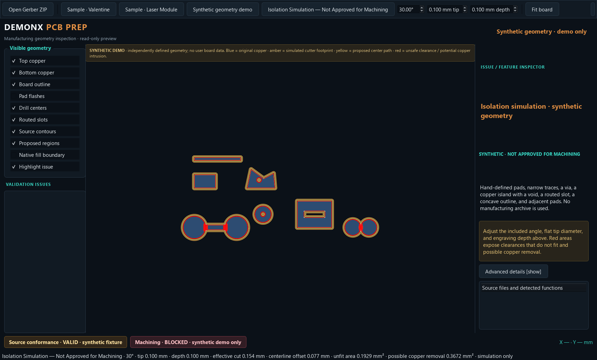

# DemonX PCB Prep — Phase 2L V-bit Geometry Foundation

**Status:** Diagnostic geometry prototype complete; owner review requested.
**Manufacturing approval:** Withheld. Real-board simulation remains refused.
**Branch/base:** `codex/pcb-prep-phase-2a`, starting at `029acc137733aacbf1731f61ac90770451d5f434`.
**Scope stop:** No production toolpaths, G-code, machine control, `.dxd` writing, or changes to DemonX Design/CNC.

## 1. Result

Phase 2L adds a shared internal canonical material view for PCB Prep’s inspection canvas and a diagnostic-only V-bit isolation prototype. Both render from the same composed material object. A synthetic example can be simulated with an explicit **Isolation Simulation — Not Approved for Machining** label. Simulation is refused for loaded boards while source conformance, independent verification, or machining eligibility is unresolved.

The Phase 2J schema and geometry contract remain unchanged. Phase 2L defines a separately versioned internal 1.1 envelope and proposes only additive optional fields for a future external 1.x contract; it does not make that external revision or authorize transfer. No source archive, Gerber, native design, or manufacturing input was modified.

## 2. Architecture

`phase2g/pcbprep/inspection_model.py` continues to own archive safety, Gerber/Excellon parsing, ordered polarity composition, strict source-region interpretation, recovery evidence, and validation findings. After composition it creates `CanonicalGeometry` with millimetre units, a source-defined right-handed board frame, explicit identity top/bottom transforms, no implicit mirror, per-layer provenance, source feature references, composed material, original drill records, and separate statuses. The inspection canvas reads top/bottom/profile from this canonical object. The isolation planner receives the same material object; it does not parse files or repair polygons independently.

Polygon material is serialized as normalized little-endian WKB plus GeoJSON, including polygon exteriors, voids, and disconnected islands. Sorted compact UTF-8 JSON is hashed with SHA-256. Source feature type, coordinates, polarity, file hash, and parser tessellation metadata remain separate from the derived polygon material. Original circular holes and routed slots preserve source diameters and coordinates. Hypothetical isolation paths never overwrite either.

The source arc and line records remain available through the existing parser feature inventory. This phase does not yet provide an all-analytic copper material kernel: the composed inspection polygons inherit the existing Phase 2A polygonization and GEOS composition limits. The Phase 2J 1.0 interchange envelope is unchanged and no receiver exists.

The new synthetic demo uses independently authored pads, traces, a circular via/hole, a polygon void, a copper island, a concave outline, a routed slot, close pads, and distinct top/bottom coordinates. The simulation canvas is labeled as synthetic and does not reuse a board archive.

## 3. V-bit model and dimensions

All internal dimensions are millimetres. Included angle means the full angle between both cutter flanks, so the half-angle appears in the idealized footprint equation:

```text
effective_cut_width = tip_diameter + 2 × depth × tan(included_angle / 2)
centerline_offset = effective_cut_width / 2
```

The initial cutter is 30° included angle with a 0.100 mm flat tip. At 0.100 mm depth the calculated width is **0.153589838 mm** and the centerline offset is **0.076794919 mm**. At 0.200 mm depth the width is **0.207179677 mm**. Tests also cover 60° and 90° cutters and several tip diameters. `calibration_scale` is an explicit positive multiplier for later measured cutter calibration; the ideal model remains the default.

Angle must be finite and strictly between 0° and 180°. Tip diameter must be finite and nonnegative. Depth must be finite and in `[0, 2.0] mm`; 2.0 mm is the Phase 2L preview input limit, not a rated cutter limit. A planner call with zero effective width is rejected. The UI exposes the included angle, flat tip diameter, and depth as editable controls.

The circle tessellation helper selects GEOS segments per quadrant from the declared sagitta target. For radius 0.8 mm and target 0.002 mm, it selects 12 segments per quadrant, giving a chord sagitta below 0.002 mm. Planner default is 0.002 mm. This bounds circular chord approximation only; it does not bound GEOS topology changes, offset joins, floating-point overlay, screen rendering, or real cutter error.

## 4. Isolation diagnostic behavior

The prototype expands each valid copper component by half the effective width and uses the resulting boundaries as proposed center contours. It sweeps a half-width footprint around those contours for display. Intersections between expanded copper components and voids whose offset contour disappears are reported as **isolation cannot fit**. The swept footprint’s intersection with canonical copper is reported separately as **potential unintended copper removal**. Narrow features and unsafe areas are not discarded silently. There is no automatic closure, snapping, mirroring, guessed material, or generic `make_valid` call in the isolation planner.

The demo’s initial 30° / 0.100 mm tip / 0.100 mm depth setting reports 0.1929 mm² of unfit clearance and 0.3672 mm² of possible copper removal. These are synthetic diagnostic values, not production metrics. Red indicates those unsafe areas; blue indicates original copper, amber the footprint, and yellow the proposed center contours.



The preview remains optional. Attempting to turn it on for an unresolved loaded document is refused with an explanation. The simulation control and cutter fields are disabled during asynchronous archive import. The normal centered import progress overlay and existing source issue guidance remain in place.

## 5. Status separation and retained blockers

The canonical model independently records source conformance (`VALID`, `NONCONFORMING`, `UNKNOWN`), independent geometry verification (`VERIFIED`, `PARTIAL`, `NOT_VERIFIED`), and machining eligibility (`ELIGIBLE`, `CONDITIONAL`, `BLOCKED`). Eligibility requires valid source conformance and verified geometry. Actual PCB Prep archives remain `BLOCKED`; no loaded board reaches the simulation canvas.

Phase 2K findings remain in force:

- Valentine original Gerber and Export A strict bottom material remain identical; Export B remains within 0.000010 mm boundary displacement.
- Valentine strict bottom regions retain 103 and 14 voids. Native cached-fill correspondence remains partially unresolved.
- Laser retains 182 open contours. Its 181 native-fill correspondences remain display-only proposals.
- Laser region 79 retains its 0.284123 mm mismatch.
- Both boards remain manufacturing-blocked.

No test or synthetic result changes those decisions.

## 6. Verification

The complete expanded runner is `phase2i/run_regressions.ps1`. It runs the historical Phase 2A–2I regression sequence followed by Phase 2J, 2K, and 2L. The final run passed **119 tests**: A 16, B 7, C 9, D 19, E 16, F 9, G/H 5, I 7, J 8, K 7, and L 16.

Phase 2L’s 16 tests cover:

- Width calculations over angle, depth, and tip cases; invalid angles, units, diameter, depth bounds, and calibration.
- Half-width centerline offset, clearance collisions, narrow holes, annular vias, pads, voids, islands, concave shapes, and slots.
- Circle sagitta error target, deterministic canonical JSON/hash, explicit coordinate side transforms, and three independent validation statuses.
- Draft 2020-12 Phase 2L envelope validation, identical canonical geometry between inspection and simulation, real sample archive loading, and refusal for unresolved manufacturing geometry.
- Valentine’s two regions and Laser’s 182 contours, 181 proposals, region 79 blocker, and machining-blocked status.

Existing Phase 2J/2K unit suites passed. The repository reports its existing PyGerber/Gerbonara parser warnings for Ucamco block examples and Excellon header ordering; these are unchanged and are not treated as conformance passes. `git diff --check` is part of the final review.

## 7. Numerical limits and remaining geometry risks

- GEOS/Shapely buffering is a polygonal diagnostic, not an exact cutter-envelope solver. Concave joins, nearly touching components, very small voids, and narrow necks can collapse or change topology. Some changes are flagged through expanded component intersections and vanished holes; this is not a proof that every unsafe topology change is found.
- The selected chord-error bound applies to circle tessellation. The complete error budget for source interpretation, arcs, booleans, offset topology, and downstream rendering has not been independently proven.
- The reported swept-footprint overlap includes measurable polygon approximation / overlay effects even for otherwise clear geometry; these areas are deliberately exposed as possible removal, not subtracted or hidden.
- Nominal cutter angle, flat, runout, wear, flex, depth calibration, board flatness, and spindle setup can differ from the ideal model. The calibration multiplier provides a future hook but there is no measured calibration profile yet.
- Composed copper that is self-touching or affected by the existing Phase 2A repair path inherits that path’s uncertainty. The planner requires nonempty valid material and does not make such a source authoritative.
- Physical double-sided registration and machining-side setup remain outside this preview. Bottom coordinates stay in the explicit source frame; no automatic mirror is applied.
- The shared canonical view is internal to PCB Prep; it is not yet a validated Design/CNC transfer contract or fully analytic source geometry engine.

## 8. Recommended next steps

1. Owner review this report, the synthetic screenshot, and the Phase 2L synthetic test results.
2. Before using geometry on real boards, independently verify analytic source arcs and polygon material semantics against a trusted reference, including every existing repair and topology blocker.
3. Add adversarial offset-topology fixtures and a formally bounded robust offset algorithm; compare full swept cutter envelopes to independent expected clearances.
4. Measure cutter geometry and effective widths across depth, calibrate the tool model, and record uncertainty separately from nominal dimensions.
5. Only after those reviews, design an operation-specific transfer contract that preserves the Phase 2J status and provenance guarantees.

**Stop point:** Mathematical isolation prototype and synthetic inspection-only preview tested. All real-board restrictions remain. Owner review is required before proceeding.
