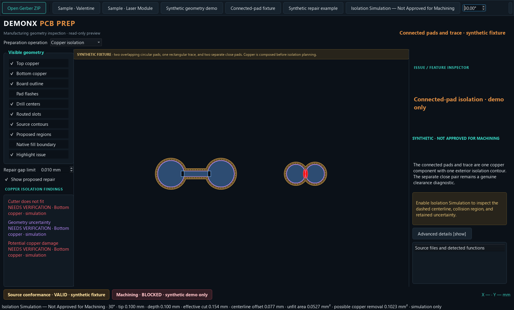
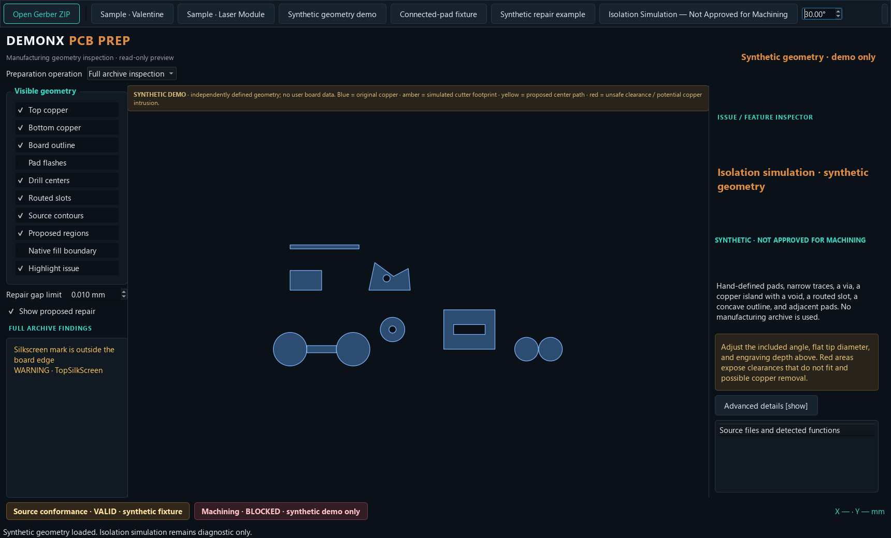
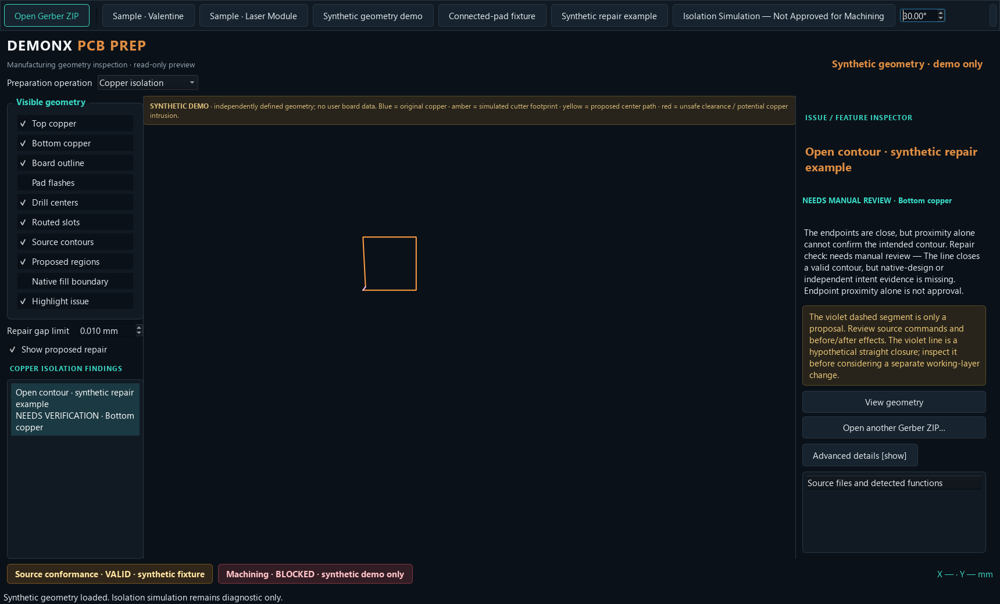

# DemonX PCB Prep — Phase 2M Repair and Isolation Workflow

**Status:** Inspection and synthetic simulation only. No production toolpaths or machining authorization.
**Branch:** `codex/pcb-prep-phase-2a`
**Starting checkpoint:** `1bcc007` (Phase 2L)

## Summary

Phase 2M composes same-layer copper before planning exterior isolation contours, separates true component-clearance conflicts from copper intrusion and approximation uncertainty, adds operation-specific findings, and presents non-destructive open-contour repair proposals. Real-board blockers remain in force. Synthetic examples are explicitly labeled and never confer real-board eligibility.

The critical connected-pad fixture now produces one composed copper component and one closed exterior contour for its two pads and connecting trace. Its two other pads remain independent components; their 0.020000 mm separation is reported as a cutter-clearance conflict for the 0.153590 mm cutter footprint. No path crosses the pad-to-trace junctions.

## Architecture and behavior

### Canonical copper composition and isolation diagnostics

The planner consumes the same canonical material as inspection. It extracts polygonal copper on the selected layer and performs a unary union before offsetting. This removes primitive seams without changing separate components, voids, holes, or islands. Cutter-center contours are kept as separate line geometries in a `GeometryCollection`; they are not unioned into bridges when distinct components' envelopes collide.

Each issue retains its coordinates, cause, measured and required clearance, effective cut width, and unfiltered area. Diagnostics are:

- **Cutter does not fit:** distinct composed material components have less clearance than the effective cutter width.
- **Potential copper damage:** the simulated footprint reaches protected copper beyond the declared approximation band.
- **Geometry uncertainty:** raw overlap lies within the declared polygon chord-error band. The measured overlap is preserved; it is not discarded by an area cutoff.

For pairwise component offsets, the uncertainty classification band is twice the declared 0.002 mm approximation bound because both boundaries are polygonized. Footprint-over-copper uncertainty uses the material boundary buffered by the 0.002 mm bound plus an explicit 1 nm coordinate epsilon. These are spatial error budgets, not area thresholds.

### V-bit footprint

All dimensions are millimeters. The included angle is the full angle between the cutting faces:

`effective_width = tip_diameter + 2 × depth × tan(included_angle / 2)`

The diagnostic centerline offset is half the effective width. For a 30° cutter with a 0.100 mm flat tip, widths are 0.153589838486 mm at 0.100 mm depth and 0.126794919243 mm at 0.050 mm depth. Depth is adjustable up to the existing 2 mm preview limit. Optional calibration is an explicit multiplicative scale and does not change nominal cutter dimensions.

### Operation-specific review

The selector provides Copper isolation, Drilling, Board outline cutting, and Full archive inspection. Unrelated silkscreen findings remain visible in Full archive inspection but do not enter the Copper isolation issue list or its operation status. Drill and profile findings are assigned to their own operations. Source conformance, independent geometry verification, and operation-specific status remain separate; an operation that ignores an unrelated layer cannot change source conformance. The UI uses “Eligible for further review,” never production eligibility.

Valentine’s inspector now states that the February Gerber and Export A reproduce identical strict material, controlled rebuilt Export B differs by no more than 0.000010 mm at the boundary, and the cached native-fill comparison is unresolved. Selecting a comparison displays a red candidate/native overlay and teal cached-fill boundary; the expanded details retain the measured region-specific difference and the local Phase 2K evidence report is available. This is explicitly a proposed closure comparison, not proof that the Gerber is invalid; Gerber reproducibility alone does not verify manufacturing geometry. Laser’s existing proposed-closure status and region 79 discrepancy remain blocking.

### Non-destructive repair proposals

Selecting an open contour measures and displays its endpoint gap, source layer and polarity, command context, contour direction, nearby protected-copper contact/distance, and before/after material metrics. Candidate checks reject over-tolerance, unsupported curved, invalid, self-crossing, and source-command-transition cases. Any contact with protected geometry is recorded, including zero-area contact. A native boundary discrepancy above 0.005 mm refuses automatic repair. Original source geometry is never changed.

The adjustable closure review limit defaults to 0.010 mm. This is a conservative fixture-backed review threshold and is not evidence that a closure is intended. The synthetic linear fixture at that limit verifies the calculation; real archive contours remain **Needs Manual Review** unless separately supported evidence is available. Laser’s 181 prior proposals remain display-only, and its region 79 discrepancy remains unrepaired. Approval, when available for a synthetic Safe Candidate, requires explicit user action and writes only to a separate derived working layer with a deterministic audit record. It cannot authorize toolpath generation.

### Launcher

`phase2g/run_pcbprep.ps1` resolves the repository root from `$PSScriptRoot`, adds it to the inherited `PYTHONPATH` while retaining other entries, invokes the repository-local Python environment with quoted paths, restores the caller’s environment, and returns Python’s exit code. `--smoke-test-startup` creates and shows the actual Qt window, verifies it is visible, and emits `PCB_PREP_STARTUP_OK`.

Owner launch command (works from any PowerShell current directory):

```powershell
& "C:\Users\ogbul\Documents\Github\gerber_to_vectric\phase2g\run_pcbprep.ps1"
```

## Numerical results

### Connected-pad fixture, 30°, 0.100 mm tip, 0.100 mm depth

The “before” column reproduces the primitive-by-primitive diagnostic: each of five source shapes was offset separately. It therefore counts overlaps between primitives that are part of the same connected copper.

| Measurement | Before composition | After composition |
|---|---:|---:|
| Copper components used for planning | 5 primitives | 3 composed components |
| Center contours | 5 primitive contours | 3 separate component contours |
| Expanded-boundary overlap area reported as unfit | 0.398516876 mm² (includes same-copper seams) | 0.052730712 mm² (separate close pair) |
| Raw cutter-footprint overlap with copper | 0.498302104 mm² | 0.104691696 mm² |
| Measured potential copper damage | Not distinguished from composition artifacts | 0.102271723 mm² |
| Approximation-band uncertainty | Not distinguished | 0.002419972 mm² |
| Pad-to-trace junction path crossings | 0 | 0 |

The corrected fixture still reports the real close-pad clearance of 0.020000 mm versus a 0.153589838 mm effective width. The collision zone is not bridged by a generated connector. The reduction in raw overlap is not hidden: after composition it remains split into measured potential damage and the stated approximation band.

### Depth response on the broader synthetic demo

| Depth | Effective width | Unfit-clearance area | Potential damage | Geometry uncertainty | Raw possible-removal overlap |
|---:|---:|---:|---:|---:|---:|
| 0.100 mm | 0.153589838 mm | 0.192910810 mm² | 0.359562414 mm² | 0.007587723 mm² | 0.367150137 mm² |
| 0.050 mm | 0.126794919 mm | 0.146620117 mm² | 0.274201598 mm² | 0.006863195 mm² | 0.281064793 mm² |

Raw possible-removal overlap is damage plus uncertainty, with neither category suppressed. Rounded to four decimals, the measurements are 0.3672 mm² and 0.2811 mm², consistent with the earlier diagnostic observations. Decreasing depth reduces both unfit-clearance area and raw possible-removal overlap.

## Validation

- Pre-change full regression baseline: 119 tests passed.
- Final full A–M regression result: **134 tests passed** (119 existing regression tests plus 15 Phase 2M tests).
- Phase 2M includes geometry, operation filtering/status, repair classification/audit, UI selection and simulation-consistency tests, plus a subprocess test that invokes the actual PowerShell launcher from the repository root and a spaced unrelated working directory. It exercises startup with no `PYTHONPATH` and verifies that an existing `PYTHONPATH` entry containing spaces survives.
- The launcher smoke test confirms visible application startup, not import-only success.
- Existing Valentine and Laser real-sample tests re-load their archives and check prior restrictions, hashes, open contours, and region 79 evidence.
- The three screenshots below use synthetic shapes only.

### Synthetic connected-pad isolation



### Operation-specific validation



### Repair proposal requiring manual review



## Remaining risks and recommended next steps

- GEOS polygon offsets remain diagnostic. Curved source records are retained by the canonical source model, but isolation preview paths are polygonal; the declared 0.002 mm chord-error bound does not cover cutter runout, depth variation, spindle geometry, material, or machine positioning.
- A V-bit model is idealized. Real cutter geometry, wear, runout, and depth-to-width behavior require measured calibration before a later manufacturing phase.
- Repair proposals do not infer native intent. Unsupported curves, D02 transitions, self-intersections, protected-copper contact, and unresolved source comparisons require human review. Native boundary similarity is evidence, not approval.
- The connected fixture’s overlap classifier separates declared approximation noise from intrusion; precision beyond that error budget is not claimed.
- Next: owner review of the canonical-material union and diagnostics; then independent fixture review for repair-context coverage and measured-cutter calibration planning. Do not begin production toolpaths until a separately reviewed verification establishes source, geometry, tool, and setup requirements.

## Phase boundary

This phase implements mathematical isolation diagnostics, repair proposals, and an inspection UI only. It adds no G-code, CNC execution, production toolpath export, `.dxd` writing, or DemonX Design/CNC integration. Valentine and Laser Module manufacturing blocks remain.
